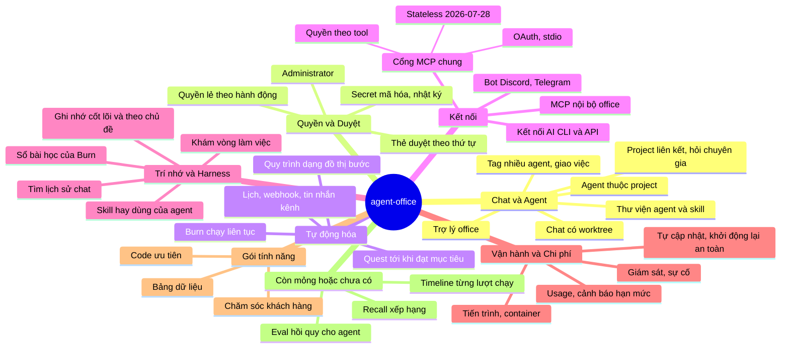

# Bản đồ agent-office

Nhìn một lần cả office: mảng tính năng → module `internal/*` → ADR trong [DECISIONS.md](DECISIONS.md). Chi tiết kiến trúc ở [ARCHITECTURE.md](ARCHITECTURE.md), giao diện ở [UI.md](UI.md).

## Chi tiết từng nhánh

### Chat và Agent
| Nút | Module | ADR |
|---|---|---|
| Chat có worktree | `internal/chat`, `internal/worktree` | 022, 037, 058, 089, 164 |
| Tag nhiều agent, giao việc | `internal/chat` (delegate) | 044, 079, 104 |
| Agent thuộc project | `internal/team` | 099, 166 |
| Thư viện agent và skill | `internal/team/library.go` | 050, 061, 153, 154 |
| Project liên kết, hỏi chuyên gia | `internal/peer` | 155, 167, 169, 177 |
| Trợ lý office | `internal/assistant`, `internal/officetools` | 045, 046, 059, 175, 182 |

### Quyền và Duyệt
| Nút | Module | ADR |
|---|---|---|
| Quyền lẻ theo hành động | `internal/perm` | 032, 035, 038 |
| Thẻ duyệt theo thứ tự | `internal/actions` | 030, 054, 084, 160, 165 |
| Administrator | `internal/perm/fullaccess.go` | 071, 074, 080 |
| Secret mã hóa, nhật ký | `internal/secrets`, `internal/audit` | 016, 043, 073, 094 |

### Tự động hóa
| Nút | Module | ADR |
|---|---|---|
| Lịch, webhook, tin nhắn kênh | `internal/automation`, `internal/trigger`, `internal/scheduler` | 040, 041, 049, 082 |
| Quy trình dạng đồ thị bước | `internal/workflow` (vd. `#website`, `#fix-tests`) | 098, 100–103, 108–111, 150, 186 |
| Burn chạy liên tục | `internal/burn` | 087, 112–149, 152 |
| Quest tới khi đạt mục tiêu | `internal/burn`, `internal/verdict` | 132, 140 |

### Kết nối
| Nút | Module | ADR |
|---|---|---|
| Cổng MCP chung (OAuth, stdio, quyền theo tool) | `internal/mcpgateway` | 091, 092, 093, 183 |
| Stateless 2026-07-28 | `internal/mcpgateway/check.go` | 157 |
| Bot Discord, Telegram | `internal/channels` | 048, 053, 063–067, 081, 083 |
| MCP nội bộ office | `internal/mcpserver` | 029, 047 |
| Kết nối AI CLI và API | `internal/llm`, `internal/provider`, `internal/clitools` | 016, 021, 028, 105, 106, 178, 179 |

### Trí nhớ và Harness
| Nút | Module | ADR |
|---|---|---|
| Ghi nhớ cốt lõi và theo chủ đề | `internal/memory` | 068, 134 |
| Skill hay dùng của agent | `internal/agentskills` (`use_skill`, `my_skills`), `skills:` của mẫu agent và bước workflow, `find_skills` + thẻ cài skill | 185, 186, 187 |
| Tìm lịch sử chat | `internal/officetools` (`search_history`) | 086 |
| Khám vòng làm việc | `internal/harness`, workflow `#better-harness` | 181, 184 |
| Sổ bài học của Burn | `internal/burn` | 131, 143 |

### Vận hành và Chi phí
| Nút | Module | ADR |
|---|---|---|
| Tiến trình, container | `internal/ops`, `internal/proctrack` | 026, 076 |
| Giám sát, sự cố | `internal/monitor` | 027, 159, 162 |
| Usage, cảnh báo hạn mức | `internal/usage`, `internal/budget`, `internal/limitalert` | 020, 069, 124, 125, 136 |
| Tự cập nhật, khởi động lại an toàn | `internal/selfupdate` | 031, 168, 180 |

### Gói tính năng
| Nút | Module | ADR |
|---|---|---|
| Mảng việc, code ưu tiên | `internal/features` | 090, 161 |
| Chăm sóc khách hàng | `internal/support` | 171, 173, 174 |
| Bảng dữ liệu | `internal/collections` | 172 |

### Còn mỏng hoặc chưa có
| Nút | Hiện có | Thiếu |
|---|---|---|
| Eval hồi quy cho agent | `internal/verdict` (một dòng ĐỒNG Ý/KHÔNG), review của Burn | Bộ việc mẫu chạy lại khi đổi prompt/model |
| Timeline từng lượt chạy | `internal/events`, `internal/usage` | Màn xem tool, thời gian, token của một lượt |
| Recall xếp hạng | `memory.Recall` khớp mọi từ, không xếp hạng | Xếp hạng (vd. SQLite FTS5) |

Không làm: vector DB, fine-tuning, synthetic data, distillation. Office điều phối agent có sẵn, không huấn luyện model.
